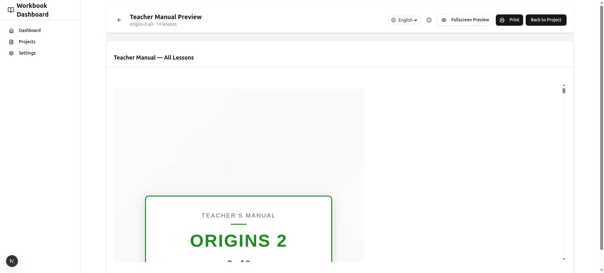

# Teacher Manual Generation

The dashboard generates a printable **Teacher Manual** for every workbook project. It is a separate, teacher-facing companion document that converts the workbook's 13 lesson steps into a structured 4-period classroom plan, with pedagogical guidance and troubleshooting.

Rendered output preview: 

## What the Manual Contains

The manual is compiled from three parts:

### 1. Front Matter

- **Title page** — series name, level, CEFR level, and a badge identifying the document as a teacher manual.
- **Preface** — an overview of the 4-period model and the blended learning approach (workbook + app + teacher anchors).
- **The Primary Advantage app** — what the teacher presses in the app, in the order of the PR teacher picture guide: sign in, find the class, start the class, assign the book, teach, after the lesson, homework, and the class sheet and QR cards. It has the 13-to-14 step map and marked black-and-white screenshots. Text: `dashboard/lib/teacher-manual/app-section.ts` (Thai, and an English working copy; not imported into the app). Screenshots: `dashboard/assets/teacher-manual/app/`, made from the Thai app captures by `dashboard/scripts/teacher-manual/mark-captures.ts` (no class code, password, or real name in a picture).
- **Lesson plan structure** — a walkthrough of all four periods and their steps.
- **Pedagogical guidelines** — pair work, discussion techniques (think-pair-share, evidence-first, cold call), using the Primary Advantage app in class (lesson page, projector, rehearsal), and blended learning management.
- **Flashcard games guide** — Memory, Go Fish, Snap, and Quiz Show, with a link to further game ideas.
- **Spelling routine guide** — the trace → write → cover-and-write cycle.
- **Goal setting introduction** — how to run the "My English Learning Goals" page.

### 2. Per-Lesson 4-Period Plans

Each lesson gets a full plan page with:

- **Lesson header** — lesson number, title, genre, article type, CEFR level, and duration.
- **Objectives and vocabulary overview** — the lesson's target vocabulary with definitions.
- **Four period plans** (see [The 4-Period Model](#the-4-period-model)), where every step renders:
  - A **"Student View" step insert** — a realistic miniature of the workbook page the students see (vocabulary table, article excerpt, comprehension questions, writing prompt, etc.).
  - **Teaching notes** — teacher actions, teacher language (model sentences), student actions, and watch-fors.
  - Per-period **bell-ringers**, **spelling activities**, and an **"In the App" box** (the steps to mark in the app and the app tools of the period).

### 3. End Matter

- **Self-assessment guide** — how to administer the student reflection page (before/during/after).
- **Certificate ceremony** — presentation tips and sample scripts.
- **Troubleshooting** — five common classroom issues (pacing, student sign-in, writing difficulty, low engagement, a closed app step) with solutions.

## The 4-Period Model

The workbook's 13 lesson steps are grouped into four 45–60 minute teaching periods.

| Period | Steps | Title | Bell-Ringer | Spelling | In the App |
| :--- | :--- | :--- | :--- | :--- | :--- |
| **1** | 1–4 | **Launch & Vocabulary** | Flashcard cut-out & organization (5 min) | — | Mark steps 1–4; projector for the article (step 3) |
| **2** | 5–7 | **Deep Reading & Comprehension** | Flashcard vocabulary game (5 min) | Trace | Mark steps 5–7; projector answers (step 7) |
| **3** | 8–10 | **Response & Practice** | Flashcard vocabulary game (5 min) | Write | Mark steps 8–10; games for the class on the projector |
| **4** | 11–13 | **Writing & Reflection** | Flashcard vocabulary game (5 min) | Cover-and-write | Mark steps 11–13; class progress; mark the lesson taught; homework (an article) |

The app text follows the new Primary Advantage app (live 2026-10-20) and only the features that the PR facts file confirms (advantage-pr `measure/tracks/boonyathat_start_kit_20261020/facts.md`). The app lesson has 14 steps and the workbook has 13: printed steps 1–8 are app steps 1–8, printed 9 is app 9 and 10, printed 10 is app 11 and 12, printed 11 (Guided Writing) has no app step, printed 12 is app 13, and printed 13 is app 14 (monorepo `packages/domain/src/primary-books/step-map.ts`). In the "Teacher-led (workbook first)" mode, a student opens an app step only after the teacher marks the matching printed step done.

### Steps by Period

- **Period 1 — Launch & Vocabulary:** 1 Before You Read · 2 Key Vocabulary · 3 Read the Article · 4 Collect Vocabulary
- **Period 2 — Deep Reading & Comprehension:** 5 Deep Reading Notes · 6 Collect Sentences · 7 Comprehension Check
- **Period 3 — Response & Practice:** 8 Guided Response · 9 Vocabulary Practice · 10 Sentence Practice
- **Period 4 — Writing & Reflection:** 11 Guided Writing · 12 Language Questions · 13 Lesson Reflection

The flashcard games rotate across periods 2–4 (Memory, Go Fish, Snap, Quiz Show), and the spelling routine progresses trace → write → cover-and-write so students practice each word three times across the unit.

## How to Use

1. Open a project in the dashboard and click the **"Teacher Manual"** button (next to "Compile All" on the project page).
2. The preview page at `/projects/<projectId>/teacher-manual/preview` compiles all lessons into a single paginated document and offers a language selector (**English** / **ไทย**).
3. Click **Print** (or Ctrl+P / Cmd+P) and save as PDF.

### Printing

- **"Background graphics" MUST be enabled** in More Settings — without it, colors, styled headers, and bordered step inserts are dropped.
- Set margins to **Default** or **None**.
- Pagination is handled by Paged.js; the print dialog runs inside the preview iframe.

### Office print PDF (A4)

Schools print the manual on an office printer, in black and white. The script makes that PDF for one project and one language:

```bash
cd dashboard
flock ~/Desktop/primary-parity-progress/heavy.lock npx tsx scripts/print/make-teacher-manual-pdf.ts origins-3.1-a0 --lang th
# default output: ~/Desktop/print-ready/teacher-manual/Primary-Advantage-Origins-3.1-Teachers-Manual-TH.pdf
```

- The `a4` paper mode (`compileTeacherManual(..., lang, 'a4')`): A4 pages with 18 mm margins on every page (also the title page), darker small text, borders on tinted boxes, and no blank sheet after the title page. The default `book` mode (210 x 285 mm, full-bleed title page) is the dashboard preview.
- Both modes use the static print fonts (`assets/print-fonts/`: Open Sans, and Sarabun for Thai), never Google Fonts. Icons are inline SVG, not emoji. There are no gradients, `rgba()` colors, or shadows, and every box has a text heading, so no meaning depends on color.
- The script loads Paged.js from `node_modules`, renders with system Chrome, and checks the PDF with `pdfinfo` and `pdffonts`. It exits with code 1 when a page is not A4, a font is not embedded, or a font is Type 3.
- The arrow "→" in the step inserts is not in the Open Sans files; Chrome takes it from a system font (Liberation Sans on the build machine, embedded as TrueType).

### Direct API Access

The compiled HTML can also be fetched directly:

```bash
curl "http://localhost:3000/api/projects/<projectId>/teacher-manual?lang=en"  # or lang=th
```

Response: `{ "html": "...", "lessonCount": 14, "totalLessons": 14, "lang": "en" }`

The `lang` query parameter is optional (defaults to `en`); any value other than `en`/`th` falls back to English.

## Implementation

- **Generator:** `dashboard/lib/teacher-manual/` — `compiler.ts` orchestrates `front-matter.ts`, `lesson-plan.ts` / `period-plan.ts` (step inserts from `step-insert.ts`, teaching notes from `teaching-notes.ts`), `end-matter.ts`, and `document-wrapper.ts` (full Paged.js print styles).
- **API route:** `dashboard/app/api/projects/[projectId]/teacher-manual/route.ts`
- **Preview page:** `dashboard/app/projects/[projectId]/teacher-manual/preview/page.tsx`
- **Localization:** all strings live in `dashboard/lib/teacher-manual/i18n/en.ts` and `i18n/th.ts`.
- **In-app lesson guides:** the monorepo imports `teachingNotesContent` and the `lessonPlanStructure.period<p>Step<n>` lines of these two files into the Primary app's lesson guides (catalogue pin). Keep the `<strong>Step n: Title</strong> — ...` form of those lines, keep four non-empty note lists for each of the 13 steps, and write each teaching note so that it is also true inside the app. Tell the monorepo session before a commit that changes them.
- **Office print script:** `dashboard/scripts/print/make-teacher-manual-pdf.ts`. Tests: `dashboard/__tests__/teacher-manual-print.test.ts`.
